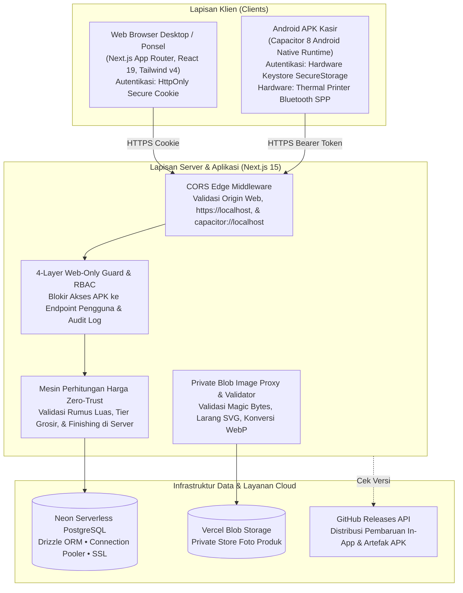

<div align="center">


# Ksatria Graphx

Sistem kasir POS, kalkulator harga percetakan, dan manajemen operasional berbasis Web & Android APK.

[](https://github.com/Smurffahh/KsatriaGraphx/releases/latest)
[](https://github.com/Smurffahh/KsatriaGraphx/actions/workflows/android-apk.yml)
[](https://nextjs.org/)
[](https://react.dev/)
[](https://www.typescriptlang.org/)
[](https://tailwindcss.com/)
[](https://orm.drizzle.team/)
[](https://neon.tech/)
[](https://capacitorjs.com/)

[Aplikasi Web](https://ksatriagraphx.vercel.app) · [Unduh APK Terbaru](https://github.com/Smurffahh/KsatriaGraphx/releases/latest) · [Catatan Perubahan](./CHANGELOG.md) · [Panduan Build APK](./docs/android-apk-build.md)

</div>

---

## Ringkasan Sistem

Ksatria Graphx membagi alur operasional percetakan menjadi dua antarmuka yang terintegrasi:

1. **Web Browser (Komputer / Laptop):** Digunakan oleh pemilik usaha (*Owner*) untuk memantau ringkasan omzet, mengelola katalog produk dan tarif bertingkat, meninjau laporan penjualan, mengunduh rekap CSV, serta mengatur akun kasir dan audit log keamanan.
2. **Android APK (Ponsel / Tablet):** Digunakan oleh kasir (*Kasir*) untuk melayani transaksi di meja kasir, mengecek harga cetak cepat, membandingkan bahan alternatif bersama pelanggan, mencetak nota ke printer thermal Bluetooth (58mm/80mm), dan mengirim rincian nota langsung ke WhatsApp.

### Matriks Kemampuan: Web vs Android APK

| Modul & Kemampuan | Web System | Android APK | Keterangan Teknis |
| :--- | :---: | :---: | :--- |
| **Kalkulator Cepat & Komparasi** | Ya (`Alt+K` / Top Bar) | Ya (FAB Mengambang) | Pemilih katalog visual berfoto, filter kategori, hitung selisih harga, salin draf WA, dan tombol lanjut ke POS anti-timpa keranjang. |
| **Kasir POS & Transaksi Cetak** | Ya | Ya | Perhitungan luas meteran (`AREA`) dengan batas minimal order & pembulatan luas, tarif bertingkat (`UNIT`), opsi finishing, dan penomoran nota otomatis (`KGX-...`). |
| **Pembayaran & Piutang (DP)** | Ya | Ya | Status lunas (*PAID*), uang muka (*PARTIAL*), dan bayar nanti (*UNPAID*) dengan pencatatan pelunasan bertahap. |
| **Cetak Struk Thermal Bluetooth** | Browser Dialog / PDF | Native Bluetooth SPP | Cetak langsung ke printer thermal portabel 58mm/80mm via plugin Java native `ThermalPrinterPlugin.java`. |
| **Simpan Gambar Nota & Kirim WA** | Ya | Ya | Ekspor nota format gambar PNG bersih dan tautan langsung ke obrolan WhatsApp pelanggan. |
| **Katalog Produk & Unggah Foto** | Ya | Ya | Manajemen produk, kategori, dan finishing. Kompresi gambar otomatis ke WebP via `sharp` dan disimpan di Vercel Blob Private Store. |
| **Laporan Omzet & Ekspor CSV** | Ya | Ya | Rekapitulasi transaksi, omzet bruto, dan arus kas per metode bayar dengan sanitasi formula CSV (anti-formula injection). |
| **Deteksi Pembaruan Aplikasi** | Notifikasi Dialog | Dialog & Unduh Otomatis | Terhubung langsung ke GitHub Releases API (`GET /api/app/version`) dengan tombol cek manual di menu Pengaturan. |
| **Manajemen Pengguna & Izin** | Ya (Khusus Owner) | Diblokir Total (403) | Diproteksi oleh 4-Layer Web-Only Guard. Akses via APK ditolak di level middleware, route handler, dan UI gate. |
| **Audit Log Forensik** | Ya (Khusus Owner) | Diblokir Total (403) | Rekam jejak immutable untuk setiap aktivitas login, perubahan data, dan transaksi sensitif. |

---

## Arsitektur Sistem



---

## Teknologi & Dependensi Utama

Seluruh dependensi yang digunakan pada repositori ini dicantumkan secara faktual berdasarkan `package.json`:

| Kategori | Paket / Teknologi | Versi | Peran dalam Sistem |
| :--- | :--- | :--- | :--- |
| **Kerangka Utama** | `next` | `15.5.29` | Kerangka full-stack App Router, SSR, Server Components, dan API Route Handlers. |
| | `react`, `react-dom` | `19.0.0` | Pustaka antarmuka pengguna berbasis komponen. |
| | `typescript` | `5.9.3` | Sistem tipe statis untuk keandalan kode end-to-end. |
| **Desain & UI** | `tailwindcss`, `@tailwindcss/postcss` | `4.3.5` | Framework CSS utility-first generasi v4 berbasis CSS tokens `@theme`. |
| | `motion` | `14.14.0` | Pustaka animasi GPU-accelerated untuk sistem splash screen, stagger login, layoutId indicators, dan micro-interactions adaptif. |
| | `next-themes` | `0.4.6` | Manajemen tema Mode Terang dan Mode Gelap berbasis variabel CSS OKLCH. |
| | `@radix-ui/react-dialog` | `1.3.1` | Primitif modal dialog yang dapat diakses penuh (WAI-ARIA). |
| | `@radix-ui/react-slot` | `1.5.0` | Komposisi elemen polimorfik untuk tombol dan tautan. |
| | `@radix-ui/react-switch` | `1.4.1` | Komponen tombol toggle untuk mode perbandingan bahan. |
| | `@tanstack/react-query` | `5.108.2` | Manajemen state server, caching, dan sinkronisasi data katalog kasir. |
| | `lucide-react` | `1.77.0` | Kumpulan ikon SVG konsisten untuk seluruh antarmuka. |
| | `recharts` | `2.15.4` | Grafik visualisasi tren penjualan dan pendapatan pada Dashboard. |
| | `sonner` | `2.0.8` | Notifikasi toast responsif dengan aksi cepat. |
| | `class-variance-authority`, `clsx`, `tailwind-merge` | Terpasang | Manajemen variasi kelas CSS Tailwind dinamis tanpa konflik. |
| **Backend & Basis Data** | `@neondatabase/serverless` | `1.2.1` | Driver koneksi PostgreSQL serverless via WebSocket connection pooling. |
| | `drizzle-orm`, `drizzle-kit` | `0.45.4` / `0.31.11` | TypeScript ORM tipe-aman, skema database, dan alat migrasi. |
| | `jose` | `6.0.8` | Pustaka kriptografi untuk signing dan verifikasi JWT token (Access & Refresh). |
| | `bcryptjs` | `3.0.2` | Hashing kata sandi satu arah dengan cost factor 12. |
| | `server-only` | `0.0.1` | Penjaga modul agar kode sensitif server tidak bocor ke bundel klien. |
| **Media & Validasi** | `@vercel/blob` | `2.9.0` | SDK penyimpanan media foto produk di cloud storage privat Vercel. |
| | `sharp` | `0.35.5` | Pemrosesan citra performa tinggi di sisi server (resize, kompresi, dan konversi WebP). |
| | `zod` | `4.6.7` | Validasi skema data masukan secara ketat di sisi server. |
| **Mobile Native (Android)** | `@capacitor/core`, `@capacitor/android` | `8.6.2` | Runtime jembatan native Android untuk aplikasi web Next.js. |
| | `@capacitor/filesystem`, `@capacitor/share` | `8.1.5` / `8.0.3` | Penyimpanan berkas sementara nota dan integrasi berbagi ke aplikasi WhatsApp. |
| | `@aparajita/capacitor-secure-storage` | `8.0.1` | Penyimpanan token terenkripsi berbasis Android Keystore hardware. |
| **Pengujian Mutu** | `vitest` | `3.2.7` | Runner pengujian unit, penetrasi keamanan, dan logika perhitungan harga. |
| | `@playwright/test` | `1.65.1` | Pengujian end-to-end multi-viewport (Desktop 1280x800 & Mobile 375x812). |

---

## Standar Keamanan Sistem

> [!IMPORTANT]
> **Kebijakan Keamanan Ksatria Graphx:**
> 1. **4-Layer Web-Only Guard:** Rute administratif sensitif (`/api/users/**`, `/api/audit-logs/**`, `/api/settings/**`) dilindungi 4 lapis verifikasi: header platform, User-Agent, Origin, dan validasi sesi database. Permintaan dari Android APK ditolak dengan status HTTP 403 Forbidden.
> 2. **Autentikasi Terpisah:** Browser Web menggunakan cookie `HttpOnly`, `SameSite=Lax`, dan `Secure`. Aplikasi Android APK menggunakan Bearer Token yang disimpan di Android Keystore terenkripsi hardware via Secure Storage.
> 3. **Perhitungan Harga Zero-Trust:** Seluruh nominal subtotal, diskon, tarif bertingkat, dan biaya finishing dihitung ulang secara mutlak di server melalui fungsi `calculateOrderItem`. Input harga manual dari klien tidak dipercaya.
> 4. **Isolasi Media & Anti-Malware:** File upload diperiksa menggunakan *Magic Bytes Signature* header biner (hanya JPEG, PNG, dan WebP yang diizinkan). Format SVG ditolak untuk mencegah serangan Stored XSS. Berkas dioptimasi ke WebP dan disimpan dalam private storage Vercel Blob yang hanya bisa diakses via proxy terotentikasi.
> 5. **Integritas Transaksi Atomik:** Pembuatan nota dan pengurangan stok dijalankan dalam transaksi database terisolasi (`SELECT ... FOR UPDATE`) untuk mencegah kondisi balapan (*race condition*) pada penomoran nota kasir.

---

## Panduan Menjalankan Proyek Secara Lokal

### Prasyarat Perangkat Lunak
- **Node.js:** Versi 20 LTS atau 22 LTS
- **Package Manager:** `pnpm` (versi 10 atau yang lebih baru)
- **Basis Data:** Instans database PostgreSQL (disarankan [Neon Serverless](https://neon.tech))
- **Penyimpanan Media:** Token [Vercel Blob](https://vercel.com/docs/storage/vercel-blob)

### Langkah Pemasangan

1. **Clone repositori:**
   ```bash
   git clone https://github.com/Smurffahh/KsatriaGraphx.git
   cd KsatriaGraphx
   ```

2. **Pasang seluruh dependensi:**
   ```bash
   pnpm install --frozen-lockfile
   ```

3. **Siapkan berkas environment:**
   ```bash
   cp .env.example .env.local
   ```
   Buka berkas `.env.local` dan sesuaikan nilainya dengan kredensial database Neon serta kunci rahasia lokal Anda.

<details>
<summary><strong>Lihat daftar variabel environment (.env.example)</strong></summary>

| Variabel | Deskripsi | Kebutuhan |
| :--- | :--- | :--- |
| `DATABASE_URL` | URL koneksi Neon PostgreSQL dengan parameter `sslmode=require` (Pooled) | Wajib |
| `DATABASE_URL_UNPOOLED` | URL koneksi langsung Neon PostgreSQL untuk migrasi Drizzle | Wajib |
| `BLOB_READ_WRITE_TOKEN` | Token baca-tulis akun Vercel Blob Storage | Wajib |
| `JWT_ACCESS_SECRET` | Kunci rahasia signing JWT Access Token (minimal 32 karakter acak) | Wajib |
| `JWT_REFRESH_SECRET` | Kunci rahasia signing JWT Refresh Token (wajib beda dari Access Secret) | Wajib |
| `DEFAULT_OWNER_NAME` | Nama tampilan akun Pemilik Usaha pertama saat seeding | Opsional |
| `DEFAULT_OWNER_USERNAME` | Username login akun Pemilik Usaha pertama saat seeding | Opsional |
| `DEFAULT_OWNER_EMAIL` | Alamat email akun Pemilik Usaha pertama saat seeding | Opsional |
| `DEFAULT_OWNER_PASSWORD` | Kata sandi login akun Pemilik Usaha pertama saat seeding | Wajib saat seed |
| `APP_WEB_ORIGIN` | Domain resmi aplikasi web (misal `https://ksatriagraphx.vercel.app`) | Wajib |
| `ALLOWED_ORIGINS` | Daftar origin CORS yang diizinkan (dipisah koma tanpa spasi) | Wajib |
| `NEXT_PUBLIC_APP_URL` | URL dasar aplikasi klien web | Wajib |
| `NEXT_PUBLIC_API_BASE_URL` | Base URL target endpoint API untuk klien Android APK | Wajib |

</details>

4. **Sinkronkan skema dan seed data awal:**
   ```bash
   pnpm run db:push
   pnpm run db:seed
   pnpm run db:seed:catalog
   ```

5. **Jalankan server pengembangan lokal:**
   ```bash
   pnpm run dev
   ```
   Aplikasi siap diakses melalui peramban pada alamat `http://localhost:3000`.

---

## Perintah Skrip Proyek

Semua skrip di bawah ini terdaftar resmi pada berkas `package.json`:

| Perintah | Fungsi |
| :--- | :--- |
| `pnpm run dev` | Menjalankan server pengembangan Next.js lokal pada port 3000. |
| `pnpm run build` | Menjalankan kompilasi produksi Next.js untuk deployment Web. |
| `pnpm run build:web` | Perintah alternatif untuk kompilasi produksi Web. |
| `pnpm run build:mobile` | Mengekspor aset statis Next.js ke folder `out/` dengan pengamanan route server otomatis. |
| `pnpm run build:apk:assets` | Alias untuk penyiapan aset statis Android APK. |
| `pnpm run cap:sync` | Menyinkronkan aset dari `out/` dan plugin Capacitor ke folder proyek Android. |
| `pnpm run cap:open:android` | Membuka proyek Android di Android Studio lokal. |
| `pnpm run start` | Menjalankan server Next.js hasil build produksi secara lokal. |
| `pnpm run typecheck` | Memeriksa kepatuhan tipe TypeScript (`tsc --noEmit`). |
| `pnpm run lint` | Menjalankan linter Next.js/ESLint untuk memastikan standar penulisan kode. |
| `pnpm test` | Menjalankan seluruh pengujian unit dan integrasi berbasis Vitest. |
| `pnpm run test:watch` | Menjalankan Vitest dalam mode watch interaktif saat pengembangan. |
| `pnpm run test:e2e` | Menjalankan pengujian fungsional browser Playwright E2E. |
| `pnpm run db:push` | Menyinkronkan skema Drizzle langsung ke database PostgreSQL. |
| `pnpm run db:generate` | Menghasilkan berkas migrasi SQL berdasarkan perubahan skema Drizzle. |
| `pnpm run db:migrate` | Menjalankan migrasi SQL ke database target. |
| `pnpm run db:studio` | Membuka antarmuka Drizzle Studio di browser untuk inspeksi data. |
| `pnpm run db:seed` | Menginisialisasi akun Owner dan pengaturan toko awal. |
| `pnpm run db:seed:catalog` | Menyuntikkan 13 produk percetakan inti dan kategori default secara non-destruktif. |

---

## Distribusi & Rilis Android APK

Aplikasi Android dibangun dan dirilis secara otomatis di cloud menggunakan GitHub Actions melalui berkas alur kerja [`.github/workflows/android-apk.yml`](./.github/workflows/android-apk.yml):

1. **Rilis Otomatis Berbasis Git Tag:**
   Setiap kali tag versi SemVer baru di-push ke repositori (misalnya `v1.2.1`), GitHub Actions akan:
   - Menjalankan build Android dengan Java 21 dan Android SDK.
   - Menandatangani file APK menggunakan Keystore resmi dari GitHub Secrets.
   - Mengoptimasi ukuran berkas via R8/ProGuard.
   - Membuat Release resmi di GitHub lengkap dengan berkas APK, ringkasan `SHA256SUMS.txt`, dan catatan rilis otomatis yang diambil dari [CHANGELOG.md](./CHANGELOG.md).
2. **Pembaruan Dalam Aplikasi (In-App Update):**
   Aplikasi kasir yang terpasang di HP secara otomatis memeriksa pembaruan via endpoint `GET /api/app/version`. Bila versi baru tersedia di GitHub Releases, kasir akan menerima pemberitahuan dan dapat mengunduh berkas APK terbaru dengan satu sentuhan.

> Pelajari tata cara konfigurasi Keystore dan pembuatan APK manual pada [Panduan Build Android APK](./docs/android-apk-build.md).

---

<details>
<summary><strong>Lihat struktur direktori proyek</strong></summary>

```text
KsatriaGraphx/
├── .github/
│   └── workflows/
│       └── android-apk.yml            # Pipeline Cloud CI Build & Release APK
├── android/                           # Proyek native Android (Capacitor)
│   ├── app/
│   │   ├── src/main/java/.../app/
│   │   │   ├── MainActivity.java      # Activity utama Android
│   │   │   └── ThermalPrinterPlugin.java # Plugin native Printer Bluetooth ESC/POS
│   │   ├── build.gradle               # Konfigurasi build Gradle aplikasi Android
│   │   └── proguard-rules.pro         # Aturan minifikasi R8 / ProGuard
│   ├── gradle/wrapper/                # Gradle wrapper terproteksi
│   └── build.gradle                   # Konfigurasi build Gradle root
├── docs/
│   └── android-apk-build.md           # Panduan detail distribusi & build APK
├── drizzle/                           # Berkas snapshot & migrasi SQL Drizzle
├── public/                            # Aset publik statis (manifest.json, dll.)
├── scripts/
│   ├── build-mobile.mjs               # Script build statis aman untuk Android APK
│   └── extract-changelog.mjs          # Ekstraktor catatan rilis dari CHANGELOG.md
├── src/
│   ├── app/
│   │   ├── (auth)/login/              # Halaman login otentikasi
│   │   ├── (dashboard)/               # Halaman operasional (Dashboard, POS, Orders,
│   │   │                              # Products, Customers, Reports, Settings, Users)
│   │   ├── api/                       # API Route Handlers Next.js
│   │   ├── globals.css                # Konfigurasi Tailwind CSS v4 & tema OKLCH
│   │   ├── icon.svg                   # Ikon resmi SVG aplikasi
│   │   └── layout.tsx                 # Shell layout utama aplikasi
│   ├── components/
│   │   ├── calculator/                # Kalkulator Cepat & Katalog Picker interaktif
│   │   ├── customers/                 # Modal & form manajemen data pelanggan
│   │   ├── layout/                    # AppShell, Navbar, Sidebar, UpdateNoticeModal
│   │   ├── orders/                    # Modal status pesanan & pencatatan pembayaran
│   │   ├── pos/                       # Antarmuka kasir POS, kalkulator cetak, checkout
│   │   ├── products/                  # Form modal produk, tab kategori, finishing, uploader
│   │   ├── providers/                 # React Query Provider & Next Themes Provider
│   │   ├── receipt/                   # Komponen modal struk & renderer cetak nota
│   │   ├── settings/                  # Panel printer Bluetooth thermal kasir
│   │   └── ui/                        # Komponen antarmuka modular (Button, Dialog, Sheet, dll.)
│   ├── db/
│   │   ├── schema/                    # Definisi tabel Drizzle ORM (PostgreSQL)
│   │   ├── catalog-defaults.ts        # Data awal 13 produk percetakan inti
│   │   ├── index.ts                   # Koneksi pooler database Neon Serverless
│   │   ├── seed.ts                    # Seeder data owner & pengaturan toko
│   │   └── seed-catalog.ts            # Seeder katalog produk non-destruktif
│   ├── hooks/
│   │   └── useAppUpdate.ts            # Hook deteksi versi & pembaruan aplikasi
│   ├── lib/
│   │   ├── api/                       # Helper respon API & penanganan CORS
│   │   ├── auth/                      # Guard keamanan, token JWT, password, sesi
│   │   ├── calculator/                # Logika hitung luas meteran, tier grosir, draf WA
│   │   ├── orders/                    # Generator nomor nota atomik
│   │   ├── pos/                       # Jembatan keranjang belanja anti-timpa
│   │   ├── printer/                   # Protokol printer thermal ESC/POS 58mm/80mm
│   │   ├── security/                  # Audit log, client IP, CSRF, validasi citra
│   │   ├── storage/                   # Helper upload Vercel Private Blob
│   │   └── version.ts                 # Evaluator SemVer versi aplikasi
│   ├── middleware.ts                  # Next.js Edge Middleware pelindung rute & CORS
│   └── types/                         # Definisi tipe global TypeScript
├── tests/                             # Pengujian unit, penetrasi, & E2E Playwright
├── .env.example                       # Contoh template konfigurasi environment
├── .gitignore                         # Pengamanan berkas lokal & artifak sementara
├── CHANGELOG.md                       # Log perubahan terstruktur antar versi rilis
├── capacitor.config.ts                # Konfigurasi Capacitor Android
├── next.config.ts                     # Konfigurasi Next.js & Content Security Policy
├── package.json                       # Konfigurasi paket & dependensi resmi
├── playwright.config.ts               # Konfigurasi pengujian E2E browser Playwright
├── tsconfig.json                      # Konfigurasi TypeScript compiler
└── vitest.config.ts                   # Konfigurasi pengujian unit Vitest
```

</details>

---

## Pengembang & Lisensi

- **Pengembang:** Danang Satria ([@Smurffahh](https://github.com/Smurffahh))
- **Repositori:** [github.com/Smurffahh/KsatriaGraphx](https://github.com/Smurffahh/KsatriaGraphx)
- **Riwayat Perubahan:** Lihat rincian pembaruan berkala pada [Catatan Perubahan](./CHANGELOG.md).
- **Lisensi:** Hak Cipta © 2026 Ksatria Graphx. Seluruh hak cipta dilindungi undang-undang.
